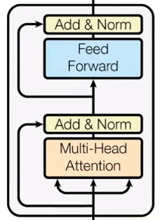

Transformer architecture was first introduced in the now famous ["Attention Is All You Need"](https://arxiv.org/abs/1706.03762) paper in 2017. The main goal of transformer is to **model long-range dependencies in sequences through parallelization** of matrix operations.

 Before transformer, the field of processing and generating text by Neural nets relied on processing tokens sequentially: $h_t = f(x_t, h_{t-1})$.  For sequence e.g. "Car has four wheels.", when processing the token "four", $x_t$ is its embedding vector, and $h_{t-1}$ is a latent representation summarizing the "Car has". $f$ (e.g. an LSTM cell) integrates the new input $x_t$ with prior hidden state $h_{t-1}$ to produce $h_t$, a (compressed) representation of "Car has four". The obvious problem is than each token is processed sequentially (token 1 -> token 2  -> token 3....), which heavily restricts the computation.  Another, major issue, which I will jsut mention and not explain to detail, is the problem with vanishing/exploding gradients during training and context loss over long sequences - at each time step $t$ the entire previous representation is compressed into a fixed size vector $h_t$...

As mentioned, transformer architecture eliminates recurrence and instead computes relationships between all tokens in parallel using process called *self attention*. But let's start from begging.

## Input
The input to an transformer is a sequence of tokens $X \in \mathbb{R}^{n \times d}$ ($n$ is the seq. length and $d$ is the embedding dimension). The model treats input as a set not an ordered sequence - permutation-invariant, thus it uses **Positional Encoding** using sinusoidal functions to inject order of tokens in sequence:

$$
\begin{aligned}
PE_{pos,\,2i} &= \sin\!\left(\frac{pos}{10000^{2i/d}}\right) \\ \\
PE_{pos,\,2i+1} &= \cos\!\left(\frac{pos}{10000^{2i/d}}\right) \\ \\
z_t &= x_t + PE_t
\end{aligned}
$$

In other terms, instead of attaching indices tokens, the transformer gets a unique vector in $\mathbb{R}^d$. Using sinusoidal encoding also implies that:
$$
PE_{t+k} = A_kPE_t
$$
for some linear transformation $A_k$ enabling the model to infer relative distances. Last but not least, the fact that the pos. encodings are deterministic and not learned helps generalize the model. 

$X$ is projected into spaces:
$$
\begin{aligned}
Q = XW_Q, \quad K=XW_K, \quad V=XW_V \\ \\ \text{where} \quad W_Q, W_K, W_V \in \mathbb{R^{d\times d_k}}  \\ \\ \text{which means} \quad Q,K,V \in \mathbb{R^{n\times d_k}}
\end{aligned}
$$

## Attention

At high level, attention allows each token to look at all other tokens, score their relevance and builds a weighted combination.  
Let's lay it out on the table, the main (famous) equation of scaled dot-product attention:
$$
\boxed{
\begin{aligned}
A = \text{softmax}\left(\frac{QK^T}{\sqrt{d_k}}\right)V \\
\text{Attention}(Q,K,V) = AV
\end{aligned}
}
$$
Looking at this attention equation, the numerator: $S =QK^T \in \mathbb{R}^{n\times n}$ where each $S_{ij} = \langle q_i, k_j\rangle$ tells us how well token $i$ matches token $j$ in the learned representation space. In higher level terms, larger $S_{ij}$ means that token $j$ is more relevant to token $i$ and vice versa. The $\sqrt{d_k}$ is introduced to stabilize training as products grow with $d_k$ which could push gradients near zero (softmax saturation).

The softmax function $softmax: \mathbb{R}^K \rightarrow (0,1)^K$ where $K>1$ in its general form:
$$
softmax(z)_i = \frac{e^{z_i}}{\sum_{j=1}^Ne^{z_j}}
$$
where $z = (z_1, \dots, z_K)\in \mathbb{R}^K$ and computes each component of $softmax(\textbf{z})\in (0,1)^K$. For our attention case, this means:
$$
A_{ij} = \frac{exp(S_{ij}/\sqrt(d_k))}{\sum_{j'=1}^N exp(S_{ij'}/\sqrt(d_k))}
$$
This guarantees that $A_{ij}>0 \land \sum_j A_{ij} = 1$ and each row $A_i$ therefore shows how token $i$ distributes its attention across the entire input sequence. This builds a matrix $A$, where each row $A_i$ is a probability distribution over tokens, thus:
$$
\text{out}_i = \sum_{j=1}^n{A_{ij}v_j}
$$
is a **contextual embedding** of token $i$. Instead of utilizing just single attention for the entire sequence, the model learns several token2token pairs at once in parallel using **Multi Head Attention**:
$$
\begin{aligned}
head_h = Attention(XW_Q^{(h)},XW_K^{(h)},XW_V^{(h)}) \\ \\
MHA(X) = Concat(head_1, \dots, head_H)W_0
\end{aligned}
$$

## Transformer Block
A full transformer layer consist of:

Firstly MHA is computed, than residual connection (Add) is applied to it $X + MHA(X)$ to preserve information: each layer updates the representation. Afterwards normalization function is used for stable distribution via:
$$
LayerNorm(y_i)=\gamma \odot \frac{y_i - \mu_i}{\sqrt{\sigma_i^2+\epsilon}}+\beta
$$
where $\gamma$(scale) and $\beta$(shift/bias) are learned. Next, the Feedforward Network introduces non-linearity ($\sigma$) via $FFN(x) = \sigma(xW_1 + b1)W_2 + b_2$ where the goal is that $W_1$ expands the features, $\sigma$ transformers them and $W_2$ compresses them back into correct representation.

## Encoder & Decoder

As visible on the full architecture above, transformer is divided into Encoder and Decoder sections. The encoder produces a set of contextual representations $H = (h_1, \dots h_n)$. The decoder than generates the output autoregressively: $y_t$ is conditioned on prev. generated $y_{<t}$ and encoded input $H$. A mechanism called **CrossAttention(Q,K,V)** enables it, where $Q$ comes from decoder states and $K, V$ come from encoder output $H$. I asked LLM on this to produced an analogy, and it generated quite an intuitive one:
>Encoder is like a court that builds a complete, structured case file from all evidence; decoder is a lawyer writing the final argument, repeatedly checking that case file to pick the most relevant facts while composing each sentence. (Unspecified AI, 2026)

## Code

The following code is an implementation of transformer architecture from scratch in NumPy.