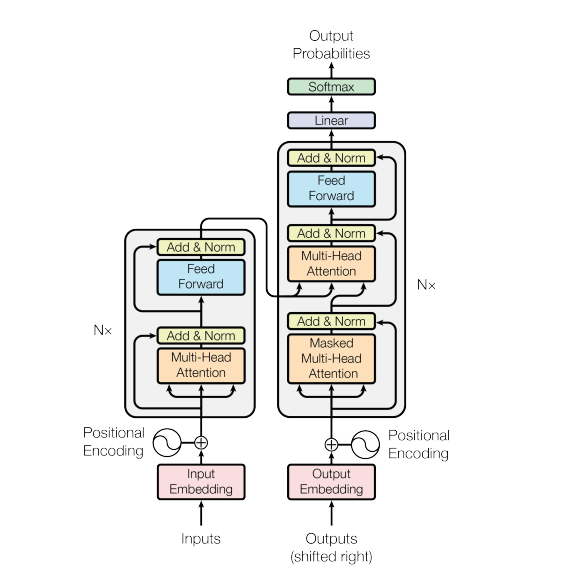
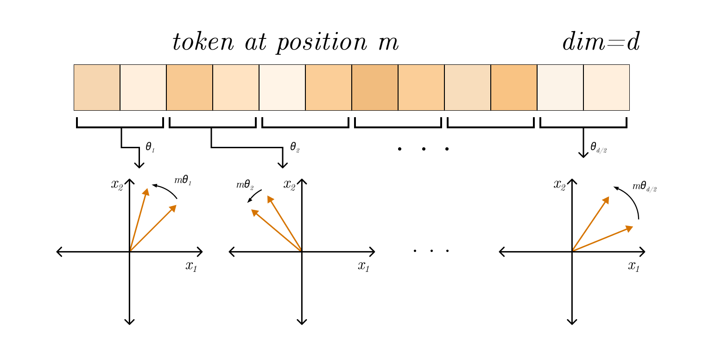

# Brief

It is now clear to say, that the Transformer architecture has withstand the test of time.

---

> The next section is concerned with explaining the Transformer architecture. Readers familiar with it can skip this section.

# Overview of Transformer

Transformer architecture was first introduced in the now famous ["Attention Is All You Need"](https://arxiv.org/abs/1706.03762) paper in 2017. The main goal of transformer is to **model long-range dependencies in sequences through parallelization** of matrix operations.

 Before transformer, the field of processing and generating text by Neural nets relied on processing tokens sequentially: $h_t = f(x_t, h_{t-1})$.  For sequence e.g. "Car has four wheels.", when processing the token "four", $x_t$ is its embedding vector, and $h_{t-1}$ is a latent representation summarizing the "Car has". $f$ (e.g. an LSTM cell) integrates the new input $x_t$ with prior hidden state $h_{t-1}$ to produce $h_t$, a (compressed) representation of "Car has four". The obvious problem is than each token is processed sequentially (token 1 -> token 2  -> token 3....), which heavily restricts the computation.  Another, major issue, which I will jsut mention and not explain to detail, is the problem with vanishing/exploding gradients during training and context loss over long sequences - at each time step $t$ the entire previous representation is compressed into a fixed size vector $h_t$...

As mentioned, transformer architecture eliminates recurrence and instead computes relationships between all tokens in parallel using process called *self attention*. But let's start from begging.

## Input
The input to an transformer is a sequence of tokens $X \in \mathbb{R}^{n \times d}$ ($n$ is the seq. length and $d$ is the embedding dimension). The model treats input as a set not an ordered sequence - permutation-invariant, thus it uses **Positional Encoding** using sinusoidal functions to inject order of tokens in sequence:

$$
\begin{aligned}
PE_{pos,\,2i} &= \sin\!\left(\frac{pos}{10000^{2i/d}}\right) \\ \\
PE_{pos,\,2i+1} &= \cos\!\left(\frac{pos}{10000^{2i/d}}\right) \\ \\
z_t &= x_t + PE_t
\end{aligned}
$$

In other terms, instead of attaching indices tokens, the transformer gets a unique vector in $\mathbb{R}^d$. Using sinusoidal encoding also implies that:
$$
PE_{t+k} = A_kPE_t
$$
for some linear transformation $A_k$ enabling the model to infer relative distances. Last but not least, the fact that the pos. encodings are deterministic and not learned helps generalize the model.

## Attention

# 